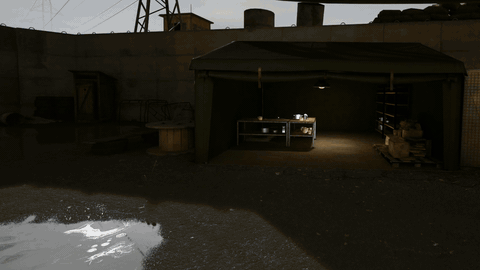

# itr-common

Bits and pieces for modding **Into the Radius 1** (PC VR, version 2.7.2). Mostly about getting custom maps into the
game, plus the stuff needed along the way.

## Example map test
1. **UE4SS:** Example used was "UE4SS for ITR1" from Nexus Mods for no particular reason
   (https://www.nexusmods.com/intotheradiusvr/mods/359; I used `UE4SS-ITR-359-v3-0-1-321-gc62ada0`).
   use vortex, or manually as that page describes. I'm not sure if it's the best one to use on nexus mods and if you are sure then you probably don't need to read this bit about how to set it up or add a lua mod. 
   - `dwmapi.dll` and `override.txt` go into `<game>\IntoTheRadius\Binaries\Win64\`;
   - the **contents** of the zip's `ue4ss\` folder go into `<game>\IntoTheRadius\Content\Paks\`, so that
     `UE4SS.dll` sits directly in `Paks`;
   - in `Paks`, rename `Mods` to `LuaMods`. The page asks for this too: the build's `UE4SS-settings.ini` reads Lua
     mods from `./LuaMods`.

   If the game hangs at startup (no window, about 12 MB of memory), `UE4SS.dll` isn't where `override.txt` points.
   That happens if you copy the `ue4ss` folder itself into `Paks` instead of its contents, as we first did.
2. **The loader:** copy [`loader-ue4ss/ITRMapLoader`](loader-ue4ss/) into `Content\Paks\LuaMods\`. Its `config.lua` is
   already set up for the example map; there is nothing to edit.
3. **The map:** copy [`example-map/prebuilt/zzz_ITRMap_Example_P.pak`](example-map/prebuilt/) into
   `<game>\IntoTheRadius\Content\Paks\`.
4. **Play:** start the game and Continue into the Hub. Pick up the **sugar cube** (the little item with the mesh
   `SM_Tea01D`, on the Hub's table). The game runs its usual transition and you arrive on the example map: a checker
   floor, walls, a hut and a ramp.
5. **Leave:** walk onto the small pad with a post, about 8 m to your left. You're taken back to the Hub through the
   same transition. On a keyboard, F10 enters the map from the Hub and leaves it again.

To undo it all, delete:
- the example pak;
- `dwmapi.dll` and `override.txt`;
- the UE4SS files in `Content\Paks`: `UE4SS.dll`, `UE4SS-settings.ini`, `LuaMods`, `LogicMods` and the rest of what
  you copied.

Details and troubleshooting: [`loader-ue4ss/README.md`](loader-ue4ss/README.md).

## Make your own
**Start here: [`map-making/guide.md`](map-making/guide.md)**. It goes from nothing to walking around your own map.

It's long and a pain in the neck because it involves building a specific unreal editor version to be able to make the materials and shaders work. If you're not using new materials then you can probably just use the normal version. Not sure, untested.

What's where:

| Path | What's in it | Tested? |
|---|---|---|
| [`map-making/guide.md`](map-making/guide.md) | The how-to: which editor, setting up the project, building the map, navmesh, packing it, getting into it | Yes, in game, except where it says otherwise |
| [`map-making/extended.md`](map-making/extended.md) | Things a mod running in the game can add on top, like spawning loot and enemies or changing the lighting | Some of it. Each part says |
| [`example-map/`](example-map/) | A small example map with scripts to build, cook and pack it, plus a prebuilt pak | Yes, in VR, including a material we compiled |
| [`loader-ue4ss/`](loader-ue4ss/) | The UE4SS Lua script that registers a custom map as a game level, enters it through the game's level transfer and brings you back. Each map's settings are in its `config.lua`; the older streaming mode is kept as a fallback | Native mode: yes, VR, with a large map; the example map's first run is pending |
| [`engine/`](engine/) | Our patches for the Oculus UE 4.27 fork so it compiles shaders the game can use, plus a `ContactShadowImpostorComponent` class fix contributed by [ChuckSharts](https://github.com/ChuckSharts/). They don't contain any of Epic's code; apply them with `tools/hashpatch.py` | The shader patches: yes, they give the same engine we built. The class fix: applies cleanly, not compile-checked yet |
| [`tools/`](tools/) | `merge_gitdeps.py` to get the fork's dependencies downloading, `hashpatch.py`, and tools for pulling shader layouts out of the exe and looking at compiled shaders | We used all of them |
| [`tools/material-export/`](tools/material-export/) | Reads a cooked game material or material instance into JSON (parent, parameters, static switches, overrides, texture settings), and an editor script that rebuilds the instance in your project. A master's graph isn't in the cooked file, so masters come out as stand-ins | Export side: compared with the SDK on 300 materials, offline. Editor script: **not run in an editor yet** |
| [`data/ub/`](data/ub/) | The game's shader parameter layouts, read out of `IntoTheRadius-Win64-Shipping.exe` 2.7.2 | |

A few notes:
- There's no Unreal Engine source in here. The patch refers to the lines it changes by hash and line number and only
  contains our lines, so you need your own copy of the engine source to apply it.
- `data/ub` is just names, offsets and sizes from the game's exe. There are no game assets in this repo.
- The Python tools need Python 3, and some need `pip install pefile capstone lz4`.

## Credits
- [ChuckSharts](https://github.com/ChuckSharts/) contributed `engine/itr-contactshadowimpostor.hashpatch.json`, which
  restores the game's `ContactShadowImpostorComponent` class in the Engine module (details in the guide, §3).

## Licence
- Everything here is under the **GNU Affero General Public License v3.0** ([`LICENSE`](LICENSE)), apart from:
  - [`engine/`](engine/), which is **MIT** ([`engine/LICENSE`](engine/LICENSE)). Those lines end up compiled into
    Unreal Engine, and Epic's EULA doesn't let engine code be mixed with copyleft licences like the AGPL. MIT means
    anyone with an engine licence can actually use it.
  - [`example-map/prebuilt/`](example-map/prebuilt/), which is a cooked package built with Unreal Engine. It has
    shader code compiled from Epic's shaders in it, so the Unreal Engine EULA applies to it rather than our licence.
  - [`data/ub/`](data/ub/), which is just data read from the game's exe. We don't claim any licence over it.
- Maps you build with the example scripts are your own work; the AGPL covers the scripts, but I've no idea how it all accumulates for your own maps etc.

## Obligatory AI Usage info
AI writes code about 10x quicker than me and it is often less frustrating than banging my head against why unreal editor wont build for hours on end(only to learn I didn't need *that* component to build anyway) and then needing to learn the ins and outs of shaders to make code edits to generate the right format used by the original game.... So in this case it made a lot happen that wouldn't have happened otherwise and the caveat that that comes with is that the 'owner' of the code in this instance(and probably most instances imho) does not have the depth of knowledge that you'd want. But this is just a basic capture of "how to make a map including your shaders/mats" so it's better to have han not to I hope.

Also the documentation... writing documentation for a repo no one will ever see is unmotivating and so without ai usage it's unlikely to have materialized.

Hopefully I've managed to cross examine and challenge the AI coding assistants enough that the solutions within are somewhat more robust than average, but I'm sure everyone says that... 
